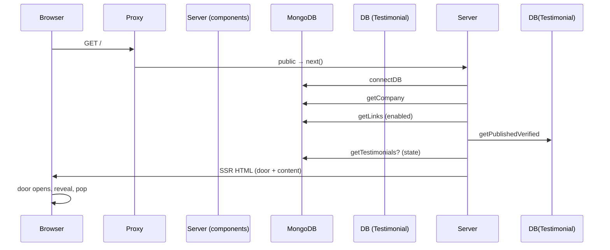

# SYSTEM ARCHITECTURE — Target Architecture

**Date:** 2026-11-20  
**Version:** 1.0  
**Summary:** Next.js App Router (v16+) monorepo on MongoDB Atlas; SSR public landing with zero-JS door animation; JWT-cookie staff dashboard; Mongoose repositories; Server Actions + Route Handlers; Proxy-guard security; optional Redis-backed rate limiting (recommended); analytics hooks later (optional).

---

## 1. Architecture Overview (ASCII)

```
                         +--------------------------------------------------+
                         |                  DEPLOY: Vercel (or Docker)       |
                         +--------------------------------------------------+
                                               |
                         +-------------------------- CDN / Edge --------------------+
                         |   Static/immutable assets + landing page (SSR)          |
                         |   / (QR destination), robots.txt, sitemap.xml, fonts/    |
                         |   public/brand/*, public/icons/*, public/images/*       |
                         +---------------------------+-------------------------------+
                                               |
                              +---------------------+------------------+
                              |     Next.js Server (16, App Router)    |
                              +---------------------+------------------+
                                               |
           +-------------------------+------------+--------------------+-----------+-----------+----------+----------+----------+
           |                                                                                                                                         |
   +---------------------+                                                                                                                    +---------------------+   +---------------------+
   |  Public (CMS/SSR)   |                                                                                                                    |  Staff (JWT + RBAC) |   +---------------------+
   |  - Landing `/`      |                                                                                                                    |  - login/logout/    |   |  Optional analytics |
   |  - Server Components |                                                                                                                    |    session          |   |  endpoints (existing)|
   |  - SEO (meta, OG,   |                                                                                                                    |  - Dashboard CRUD   |   |  (reuse if kept)    |
   |    sitemap, robots) |                                                                                                                    |  - Links CRUD       |   +---------------------+
   |  - Testimonials     |                                                                                                                    |  - Testimonials CRUD|
   +---------------------+                                                                                                                    |  - Fonts CRUD       |
                                                                                                                                              |  - Company CRUD     |
                                                                                                                                              |  - Address CRUD     |
                                                                                                                                              |  - Webhooks later   |
                                                                                                                                              +---------------------+
                                                                                                                                                  |
                                                                                                                                                  |
                                                                                                                                                  v
                                                                                                                                              +---------------------+
                                                                                                                                              |   MongoDB Atlas     |
                                                                                                                                              |  - Company          |
                                                                                                                                              |  - LinkItem         |
                                                                                                                                              |  - Testimonial      |
                                                                                                                                              |  - BrandSettings    |
                                                                                                                                              |  - User (admin)     |
                                                                                                                                              |  - Legacy e-com data|
                                                                                                                                              +---------------------+

                          +--------------------------+        +-----------------------+            +---------------------+
                          |        (Proxy)           |        |  Route Handlers       |            |  Server Actions     |
                          |  - Headers               |        |  - Public GETs        |            |  - Company CRUD     |
                          |  - Route protection      |        |  - Auth flows (new)   |            |  - Links CRUD       |
                          |  - Session decode        |        |  - CSRF verify        |            |  - Testimonials CRUD|
                          |  - Public API guards     |        |  - Rate limit         |            |  - Fonts CRUD       |
                          |  - Security headers      |        |  - Upload proxy       |            |  - Address CRUD     |
                          |  - Zod validation        |        |  - Zod validate       |            |  - Profile/address  |
                          +--------------------------+        +-----------------------+            +---------------------+

                                                                +----------------+
                                                                |  Rate limiter  | (recommended Redis / DB / in-mem fallback)
                                                                +----------------+

                                                                  +---------------+
                                                                  |  Audit log    |
                                                                  +---------------+

                                                                  +---------------+
                                                                  |  Web Vitals   | (optional — script, GA4 or self-hosted)
                                                                  +---------------+
```

---

## 2. Target Technology Stack (final)

All choices justified in DECISIONS_AND_ASSUMPTIONS.md. No new runtime deps.

| Layer | Choice | Notes |
|---|---|---|
| Framework | **Next.js 16 (App Router)** | Existing baseline. No changes to package.json allowed (§12). |
| Language | **TypeScript** (strict) | Existing. |
| React | **React 19.2** | Existing. |
| UI | **Tailwind CSS v4 + `lucide-react` + clsx/tailwind-merge + @workspace/ui (styles)** | Existing. |
| UI primitives | Custom `Button` (existing) + new atomic UI in `components/ui/*` (approved by brand doc §1.6/§3.4). |
| Icons | **Lucide React** (existing) + custom SVG for product-specific (DoorHandle etc., `components/icons/`). |
| Fonts | **`next/font/google`** — Cairo (Arabic UI), Readex Pro (Arabic display), Inter (English), JetBrains Mono (data). **NO local fonts** (Google-served; CLS-safe). |
| Database | **MongoDB Atlas + Mongoose 9.7** (existing). |
| Auth | **JWT cookie** (`jsonwebtoken`), bcryptjs hashing (or Argon2 as optional upgrade). |
| Backend | **Server Actions** (dashboard mutations) + **Route Handlers** (public/auth APIs + upload proxy). |
| Validation | **Zod 4.4** everywhere (dashboard forms, API handlers, upload). |
| Rate limiting | **In-memory → Redis/DB-backed** (strategy in §4). |
| CSRF | Double-submit for Server Actions + Route Handlers (existing). |
| Observability | `lib/activity` + `lib/audit` (existing) + new events for new actions; optional Web Vitals telemetry (§8). |
| Deploy | **Vercel** (existing style), optional Docker fallback. |

**KEEP EXISTING (planned to reuse, modified if needed):**
- `lib/auth/*` (session/guard/redirect) — hardened per §6 (session rotation, logout invalidation).
- `lib/security/csrf.ts` — retained.
- `proxy.ts` — extended with public asset bypasses + public API (`/api/company`, `/api/links`, `/api/testimonials` GET), updated PUBLIC_PATHS (see §2.3).
- `next.config.ts` headers — deduped; dashboard-specific CSP notes (§6).
- `lib/db.ts` — retained; connectDB.
- `lib/logger.ts`, `lib/responses.ts`, `lib/utils.ts`, `lib/errors.ts`, `lib/analytics.ts`? (e-commerce analytics — audit showed existing sales analytics — may be kept under dashboard/analytics for existing e-commerce? — note in dashboard route audit: reuse or replace per §2.3).
- Repository pattern (`repositories/*.repository.ts`) — reused for new models with `companyRepository`, `linkRepository`, `testimonialRepository`, `brandSettingsRepository`.
- Existing auth flows (`/api/auth/*`), `/api/upload/*` (Cloudinary) — retained.
- `services/auth.service.ts`, `services/content.service.ts` (legacy — frozen), `services/product.service.ts` (e-commerce — audit: keep under audit, not landing).

---

## 2.1 Public Routes (final URL map)

| Route | Type | Content | Notes |
|---|---|---|---|
| `/` (root) | Public SSR + door animation | New landing: brand header + 5 action cards + testimonials + trust + contact tiles | QR destination. SEO: index. |
| `/fonts` | Public client page | Font preview (debug/UX — dev-only in dashboard? Final: allow `?debug` on landing; dashboard owns the live preview) — FINAL: dev-only page in `app/(marketing)/fonts/page.tsx` (noindex, dev check) OR keep as dashboard preview only. DECIDE (§12). |
| `/login` | Public | Staff login form (Arabic) |
| `/register` | Public | Staff register form (for new admins, customer role default) |
| `/logout` | Public | Staff logout redirect |
| `/dashboard*` | Staff | Admin portal (manager+). Layout checks session. |
| `/api/*` (GET/public): `/api/company`, `/api/links`, `/api/testimonials` | Public REST | Lightweight public reads for micro-apps (e.g., contact form webhook, QR embed). Optional. |
| `/api/auth/*` | Staff (auth) | Session, logout, refresh, forgot/reset (auth ops) |
| `/api/upload/*` | Staff (auth + CSRF) | Cloudinary proxy for company media |
| `/api/*` (all others) | Staff (auth + CSRF) | Internal mutation APIs — retained where e-commerce flows exist (dashboard + small public handlers where specified). |

Notes:
- `/about`, `/brands`, `/categories`, `/checkout`, `/products`, `/projects`, `/offers`, `/contact` (OLD): **Decision required** (§12, DECISIONS.md). Defaults to redirect `/`? Or leave — (see §4.7). Final decision point.

## 2.2 Staff Routes (final dashboard map)

| Route | Page | Purpose |
|---|---|---|
| `/dashboard` | Home | New landing settings overview: stats (Company/link counts), testmode display, quick actions. (Keep e-commerce stats where still useful — reuse `dashboard/analytics`, keep e-commerce services if still used, note as optional.) |
| `/dashboard/company` | Company form | §3.1 — name/desc/logo/cover/phone/whatsapp/address/googleMaps/instaPay/cashWallet/website/email/currency |
| `/dashboard/links` | Links manager | §3.2 |
| `/dashboard/testimonials` | Testimonials | §3.4 (moderation, publish/verify/delete) |
| `/dashboard/fonts` | Fonts | §3.3 (preview, select, save) |
| `/dashboard/address` | Address & location | §3.5 |
| `/dashboard/settings` | Settings | General (site title/language override, email recipients — small additions beyond current). |
| `/dashboard/profile` | Profile | Password change, avatar update, staff email. |

### 2.3 Proxy Route Protection Update

New `proxy.ts`:
- **PUBLIC_PATHS:** `/` — landing; `/fonts`; `/login`, `/register`, `/logout`, `/privacy`, `/terms`, `/favicon.ico`, `/robots.txt`, `/sitemap.xml`, `/manifest.webmanifest`, `/google465111a5cdd76198.html`, `/images/*`, `/icons/*`, `/fonts/*` (static), `/opensearch.xml`? (no), `/sitemap*.xml` variants.
- **STAFF_PREFIX:** `/dashboard` (requires manager/admin).
- **PUBLIC API (read-only):** `/api/company`, `/api/links`, `/api/testimonials` — JSON GETs.
- **All other `/api/*`:** require staff session + CSRF + rate limit.
- Removed `/shop`, `/products`, `/categories`, `/brands`, `/about`, `/checkout`, `/cart`, `/wishlist` from PUBLIC_PATHS if removed — becomes 404 via not-found.tsx + robots allow list update + dashboard robots links update.

### 2.4 Route Handlers (final)

- `GET /api/company` → Company singleton JSON (null → seed default).
- `GET /api/links` → all links sorted.
- `GET /api/testimonials` → published + verified only (safe public projection; dashboard reads via SSR/pages + internal actions, with moderation review queue).
- `GET /api/fonts/preview`? → no, preview is a client component reading static list + fetching text client-side.
- `POST/PUT /api/upload/*` — retained Cloudinary.
- Existing `/api/auth/*` retained; new `POST /api/auth/logout` exists; new `/api/auth/revoke` optional (see §6).

### 2.5 Server Actions (final)

Staff actions (each: rate-limit-pass + CSRF-pass + Zod-parse + guarded, then mutation, then audit/revalidate):
- `(staff)/dashboard/company/actions.ts` — updateCompany.
- `(staff)/dashboard/links/actions.ts` — upsertLink, deleteLink, toggleLinkEnabled, reorderLinks.
- `(staff)/dashboard/testimonials/actions.ts` — upsertTestimonial, deleteTestimonial, togglePublished, toggleVerified.
- `(staff)/dashboard/fonts/actions.ts` — saveFonts.
- `(staff)/dashboard/address/actions.ts` — updateAddress.
- `(staff)/dashboard/profile/actions.ts` — updateProfile, changePassword.
- `(staff)/dashboard/settings/actions.ts` — updateSettings.

### 2.6 Repositories & Services (final)

- `repositories/company.repository.ts` — get/update/getBySlug? (singleton by slug: "default").
- `repositories/link.repository.ts` — list/upsert/delete/updateOrder/enable.
- `repositories/testimonial.repository.ts` — getAll/publish/unpublish/verify/delete/upsert.
- `repositories/brand.repository.ts` — new singular BrandSettings (get/set).
- `services/company.service.ts` — getCompany (cached), updateCompany, validateUrls (Zod helpers).
- `services/links.service.ts` — dynamic LinkItem CRUD + order.
- `services/testimonial.service.ts` — moderation CRUD + public queries.
- `lib/seo/metadata.ts` — finish (fix dead code, complete buildMetadata, ORM integration).
- `lib/seo/structured-data.ts` — new: LocalBusiness/Organization/WebSite/Review JSON-LD builders.

---

## 3. Data Flow & Sequence (Landing Page SSR)



## 4. Admissibility & Security Boundaries

- Server Components default; Client Components only: door animation, micro-anims, copy-to-clipboard (whatsapp), fonts preview, form inputs (server actions handle).
- Never trust client-side validation for actions — server: CSRF + role + Zod + business rules + rate limits.
- no secrets in repo: grep for `API_KEY`, `SECRET`, `TOKEN` periodically.

## 5. Compliance & Hardening Notes

- Serve `/` with `Cache-Control: no-store`? (Company data changes — use ISR revalidate=60 for demo speed; SEO target OK).
- HTML minify on, compression: gzip + Brotli (host-level).
- Prefer HTTP/2 + TLS 1.3.
- `robots.txt`: allow `/` allow list; disallow staff/API; Disallow old e-commerce pages if removed.
- `sitemap.xml`: public routes; static pages; optional dynamic legacy routes until removal.

## 6. MFA / Session Strategy

- JWT + cookie (existing).
- Password hashing: bcryptjs 12 (current). Alternative: argon2 (`argon2` package) — recommended later.
- Session rotation: add `jti` (JWT ID) claim (when rotating).
- Logout: delete cookie + denylist jti in cache/DB (optional).
- Password change: set `passwordChangedAt` in session claim; verify at load (server side): if token.iat < user.passwordChangedAt → force logout (this invalidates old JWTs on password change).
- Staff sessions: refresh endpoint (`/api/auth/refresh`) — retained.

## 7. Monitoring & Observability (Recommended)

- `lib/analytics.ts` + new `lib/telemetry.ts` (optional, dev): capture Web Vitals (FCP, LCP, TTFB, CLS, INP) to lightweight endpoint (`/api/analytics/web-vitals` or GA4).
- Internal: structured logs via `lib/logger.ts` — security events, admin actions.
- Dashboard-only: user activity via `Activity` model.

## 8. Deferred & Optional (marked for later phases)

- Google Maps API integration for embedded reviews map or reviews JSON (optional; document decision: current = external links).
- GA4/product analytics on landing — optional.
- Multi-language landing (EN) — decision point (§12).
- CDN for assets — decision point.
- Microservices/Redis scaling — decision point.

## 9. Architecture Decisions Summary (ADR-style)

- ADR-1: Next.js App Router 16 — reuses stack, App Router structure matches existing migration path.
- ADR-2: Landing SSR + door CSS animation (vs SVG, rAF, CSSOM) — best perf/reliability balance.
- ADR-3: No JS on landing beyond door component + clipboard — perf.
- ADR-4: JWT cookie + bcryptjs (existing, or argon2 optional) — matches existing security baseline.
- ADR-5: MongoDB Atlas — matches existing.
- ADR-6: Keep `Web Vitals` telemetry OFF by default until approved.

---

**End of SYSTEM_ARCHITECTURE.md**
